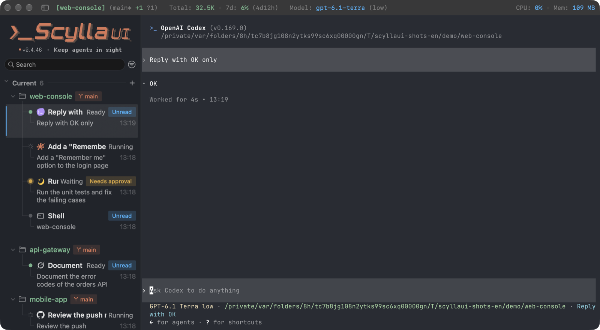
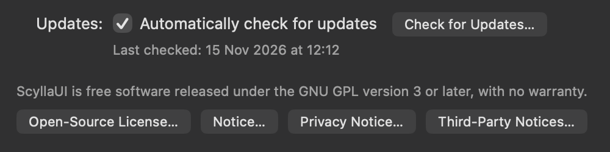
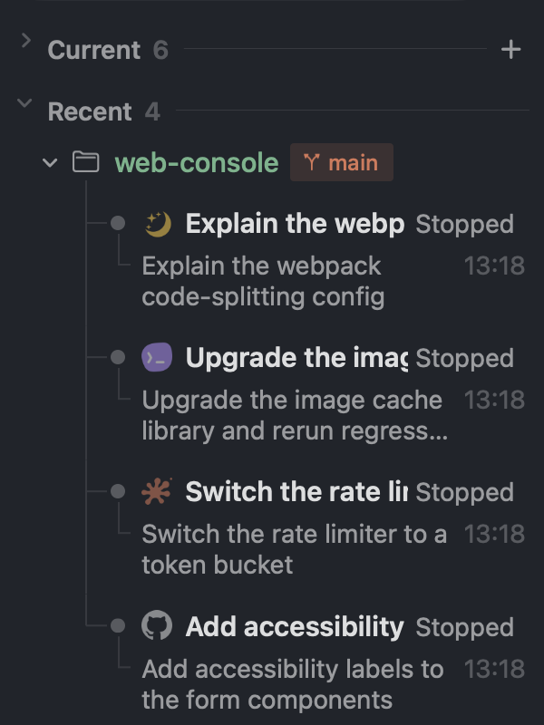
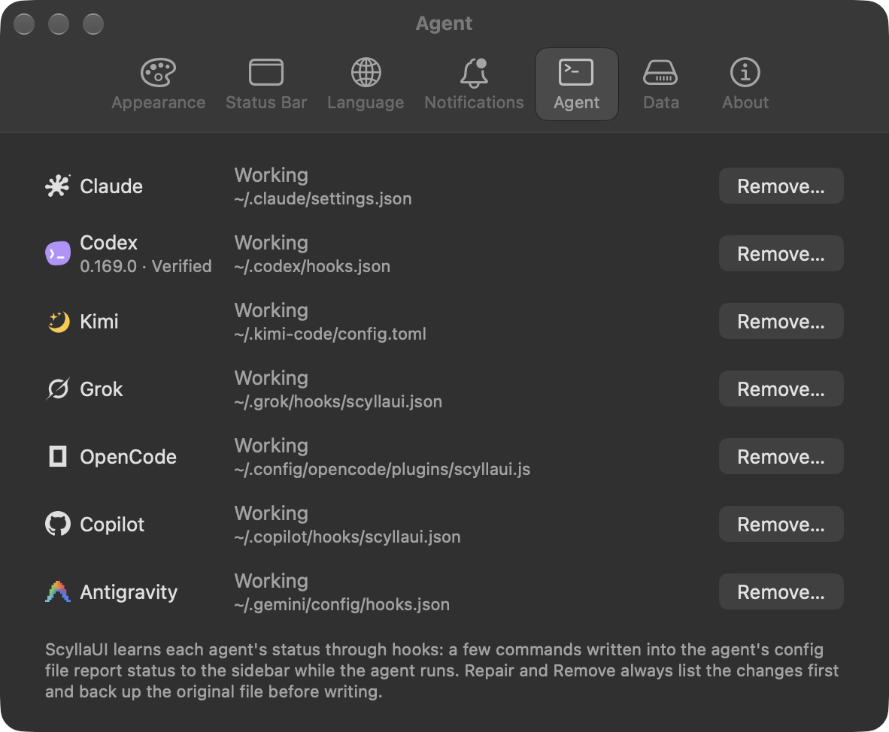
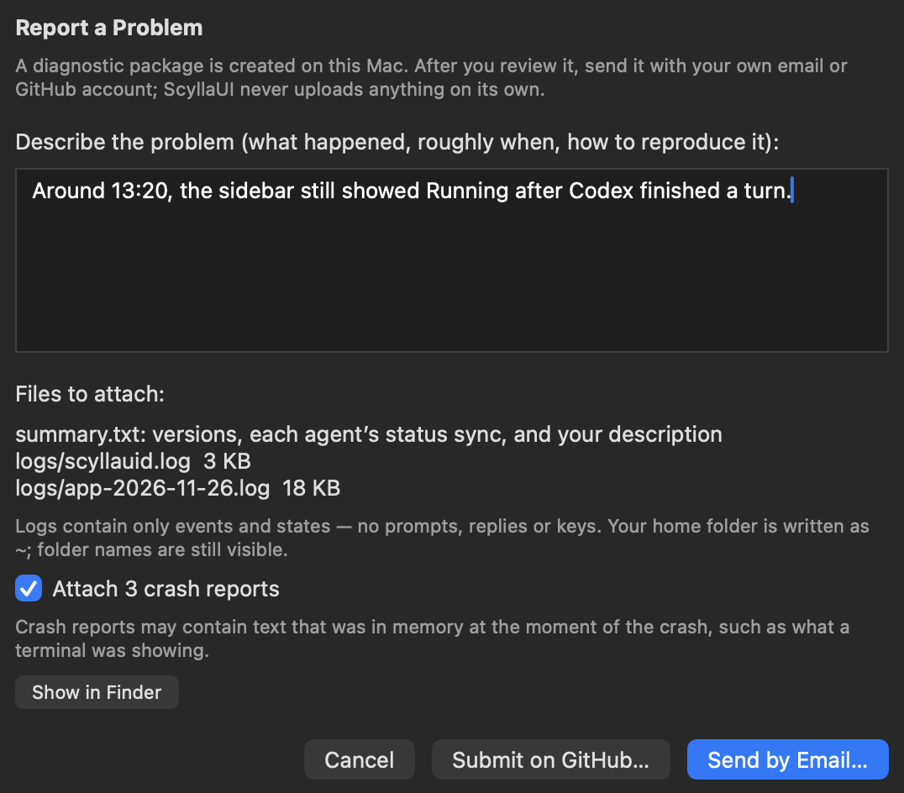
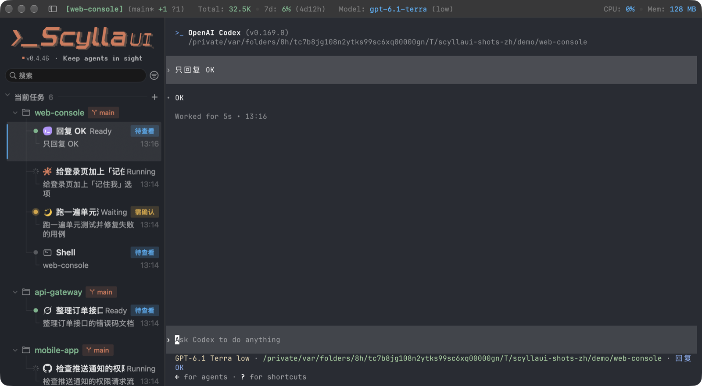
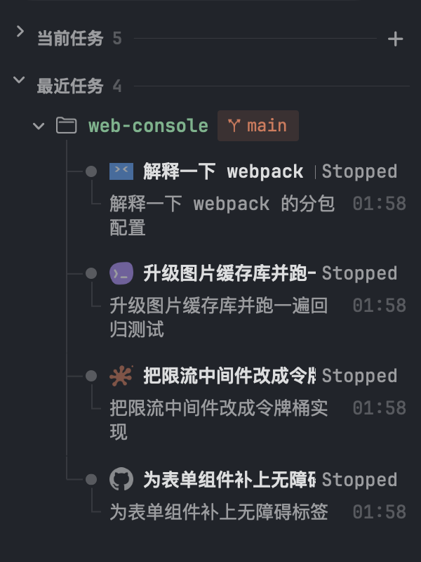
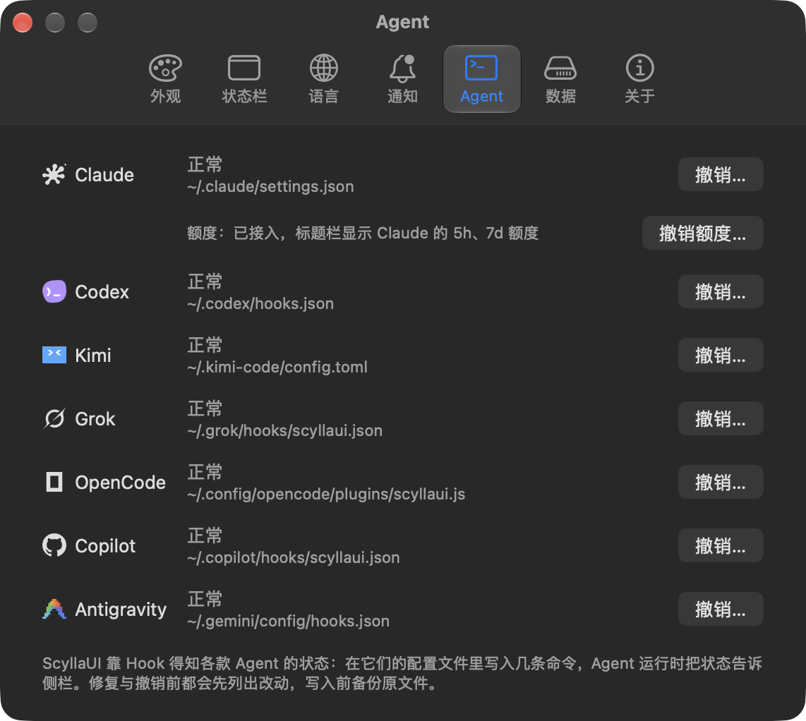
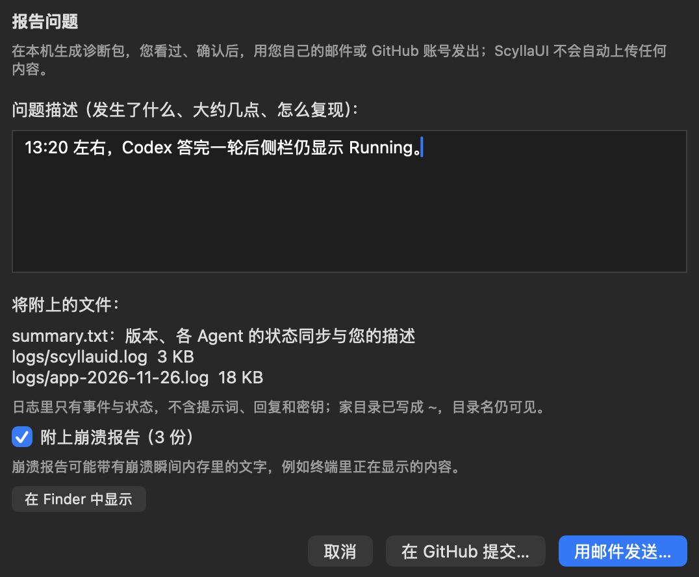

# ScyllaUI

[English](#english) · [中文](#中文)

---

## English

ScyllaUI puts your AI coding agents — Claude Code, Codex, Kimi Code, Grok Build, OpenCode, GitHub Copilot CLI and Antigravity CLI — and plain shells from all your projects into one native macOS window. The sidebar groups every terminal by project and shows, in real time, whether each agent is running, waiting for your approval, done, or failed. The right side is a full native terminal.

**Download:** [scyllaui.github.io/scyllaui](https://scyllaui.github.io/scyllaui/) (always links to the latest version)

### Features

- **One window for all terminals**: terminals are grouped under the Git repository they work in, and move automatically when you `cd` into another repository. Each project shows its current branch.
- **See what every agent is doing**: one row per terminal shows Running, Waiting (with a "Needs approval" badge), Ready or Error; a finished turn you haven't looked at yet is marked "Unread". You get a notification when an agent needs your approval, and the Dock badge shows how many are waiting (turn-finished notifications are off by default and can be turned on in Settings › Notifications). When ScyllaUI has no reliable signal, it shows "Unknown" instead of guessing.
- **Quitting doesn't stop anything**: terminals are kept by a background process. Quitting or updating ScyllaUI never ends a terminal; the agents keep running, and reopening ScyllaUI reattaches them.
- **Recent tasks**: finished AI conversations are listed under "Recent". Double-click one to open a new terminal in its original folder with the resume command typed for you.
- **Prompt History**: a side panel lists the prompts you sent in a conversation, for review and copying.
- **Status bar**: the current project's branch and changes, token usage, model and reasoning effort, your plan's usage limits, and ScyllaUI's own CPU and memory.
- **Search and filter**: search by terminal name, task title, prompt, reply or folder, and show only the terminals that need you ("Pending only").

### Requirements

| Item | Requirement |
|---|---|
| Hardware | A Mac with Apple silicon (M-series). Intel Macs are not supported |
| System | macOS 14 Sonoma or later |
| AI tools | At least one of the command-line tools below, installed and signed in with your own account. ScyllaUI does not include any AI tool and never signs in for you |
| Network | The AI tools use the network as usual; ScyllaUI itself only goes online to check for updates |

Supported command-line tools and the latest versions verified with ScyllaUI (newer versions usually work too; if a tool changes its data format, the sidebar shows "Status may be inaccurate"):

| Tool | Command to start it | Verified up to |
|---|---|---|
| Claude Code | `claude` | 2.1.325 |
| Codex | `codex` | 0.169.0 |
| Kimi Code | `kimi` | 2.6.1 |
| Grok Build | `grok` or `agent` (the same program; if `grok` doesn't start on your Mac, use `agent`) | 1.0.77 |
| OpenCode | `opencode` | 2.3.0 |
| GitHub Copilot CLI | `copilot` | 1.0.112 |
| Antigravity CLI | `agy` | 1.5.9 |

### Download and install

1. Download the latest `ScyllaUI-<version>.dmg` from the [Releases](https://github.com/scyllaui/scyllaui/releases) page.
2. Open the DMG and drag ScyllaUI into Applications. Don't run it from inside the DMG; ScyllaUI will ask you to move it first.
3. Open ScyllaUI from Applications or the Dock. The app is signed with a Developer ID and notarized by Apple, so macOS asks only once whether to open an app downloaded from the internet.
4. The first launch walks you through two things:
   - **Folder access**: when macOS asks whether ScyllaUI may access Documents, Desktop or Downloads, choose "Allow". Otherwise terminals and agents working in those folders will hang.
   - **Status sync**: ScyllaUI adds a few hook entries to each AI tool's configuration. It shows the exact changes first and writes them only after you confirm.

### Updates

- Choose ScyllaUI › Check for Updates… at any time.
- The first launch never goes online. On the second launch ScyllaUI asks whether to check for updates automatically; if you agree, it checks once a day. You can turn this on or off later in Settings › About.
- When a new version is available, ScyllaUI shows it and lets you decide; it never installs on its own. "Install Update" downloads it, verifies the signature, replaces the app and relaunches it. Running terminals and their agents are not interrupted.

### Using ScyllaUI

#### New terminals and starting an agent

- `Cmd+N` opens a new terminal in the current terminal's folder. Click "+" next to "Current" in the sidebar, or press `Cmd+O`, to start in another folder.
- Every new terminal is a plain shell. Type `claude`, `codex`, `kimi`, `grok` (or `agent`), `opencode`, `copilot` or `agy` to start an agent; its row in the sidebar starts showing its status.

#### Codex and its background daemon

Codex normally runs in daemon mode: the `codex` command connects to one shared background process (the same one used by the ChatGPT desktop app and by Codex sessions started outside ScyllaUI). In that mode ScyllaUI cannot tell which terminal a Codex event belongs to, so the sidebar could not show its status.

- **What ScyllaUI does**: in ScyllaUI terminals, typing `codex` automatically adds `--no-daemon`, so Codex runs inside that terminal by itself and the sidebar receives its status. ScyllaUI does not change your Codex configuration for this; Codex in other terminal apps is not affected.
- **Trade-off**: Codex sessions started this way don't appear in ChatGPT's remote control or in the `codex agents` list. Commands that need the daemon, such as `codex agents` and `codex queue`, run unchanged.
- **To use daemon mode anyway**: type `command codex` instead of `codex`. The terminal's row may then show "Unknown".
- **Limits**: this works only in the zsh that ScyllaUI starts.

#### Switching, renaming and closing

- Click a terminal row in the sidebar, or use `Cmd+1…9` and `Cmd+Shift+[` / `]`.
- Double-click the first line of a terminal row to rename it.
- `Cmd+W` closes the current terminal; if a program is still running in it, ScyllaUI asks first.
- `Cmd+Q` or closing the window only quits ScyllaUI; no terminal ends, and reopening reattaches them. To stop the background process as well, quit ScyllaUI, then on macOS 27 or later right-click its Dock icon and choose "Stop Running in Background"; on earlier versions run `/Applications/ScyllaUI.app/Contents/Helpers/scyllaui ctl shutdown --force` in a terminal. All terminals end with it.

#### Recent tasks

Finished AI conversations appear under "Recent" (up to 20 from the last 14 days). Click one to select it and review its prompts in Prompt History; double-click to resume. If the conversation is already running in a terminal, ScyllaUI switches to it.

#### Status sync

The sidebar status comes from each AI tool's official hooks. Settings › Agent shows whether status sync is working for each tool and lets you repair or remove it per tool (removing deletes only the entries ScyllaUI added; files are backed up before any change). If a tool's hooks were deleted, disabled, or (for Codex) not yet trusted, its row in the sidebar shows "Not synced"; click it to repair.

#### Reporting a problem

Choose Help › Report a Problem…. Describe what happened and roughly when; ScyllaUI then creates a diagnostic package on your Mac (versions, logs and crash reports — no prompts or replies). Review it with "Show in Finder", then send it with "Send by Email…" or "Submit on GitHub…" using your own account. ScyllaUI never uploads anything by itself. You can also open an issue directly in [Issues](https://github.com/scyllaui/scyllaui/issues).

#### Privacy

- Apart from checking for updates, ScyllaUI does not go online. It collects and uploads no usage data.
- Prompts, AI replies and task titles are stored only on your Mac, in `~/Library/Application Support/ScyllaUI/`; common secret patterns are masked before anything is written. Logs never contain this content.
- The full privacy notice is in the app: Settings › About › Privacy Notice… (see the screenshot under [Updates](#updates)).

More details are in the [user guide](docs/usage.md) (Chinese).

### Uninstalling

1. In Settings › Agent, click "Remove…" for each tool to delete the entries ScyllaUI added to its configuration.
2. Let the agents finish (or `exit` them) and quit ScyllaUI. Then stop the background process: on macOS 27 or later, right-click its Dock icon and choose "Stop Running in Background"; on earlier versions, run `/Applications/ScyllaUI.app/Contents/Helpers/scyllaui ctl shutdown --force` in a terminal.
3. Move ScyllaUI from Applications to the Trash.
4. If you no longer need the history and settings, delete `~/Library/Application Support/ScyllaUI/`, `~/Library/Logs/ScyllaUI/`, `~/Library/Caches/ScyllaUI/`, `~/Library/Caches/dev.scyllaui.app/`, `~/Library/Caches/dev.scyllaui.app.sparkle/` and `~/Library/HTTPStorages/dev.scyllaui.app/`. Then run `defaults delete dev.scyllaui.app` in a terminal and delete `~/Library/Preferences/dev.scyllaui.app.plist` (the command empties the settings but leaves the file).

### License

Copyright © 2026 Siyuan Zhang. All rights reserved.

- **Source code**: ScyllaUI's source code is free software, licensed under the GNU General Public License version 3 or (at your option) any later version (SPDX: `GPL-3.0-or-later`; full text in [LICENSE](LICENSE)). It comes with no warranty.
- **Artwork**: the app icon, splash artwork, `>_ ScyllaUI` wordmark, the tool icons drawn for ScyllaUI, and the screenshots are original works protected by copyright. They are **not** covered by the GPL or any other open-source license, and may not be copied, modified, redistributed or used to create derivative works without permission. See [ARTWORK.md](ARTWORK.md) for the full list and terms.
- **Name and logo**: the GPL grants no rights in the name "ScyllaUI" or its logos (GPL Section 7(e)).
- **Third-party components**: each under its own license; see `src/app/ScyllaUI/Resources/ThirdPartyNotices.txt` (in the app: Settings › About › Third-Party Notices…).
- **Contributing**: contributors must accept the [Contributor License Agreement](CLA.md); see [CONTRIBUTING.md](CONTRIBUTING.md). Report security issues privately as described in [SECURITY.md](SECURITY.md).

---

## 中文

ScyllaUI 把多个项目里的 AI 编程助手（Claude Code、Codex、Kimi Code、Grok Build、OpenCode、GitHub Copilot CLI、Antigravity CLI）和普通 Shell 放进同一个原生 macOS 窗口：左侧侧栏按项目管理所有终端，实时显示每个 Agent 正在运行、等您确认、已经做完还是出错；右侧是完整的原生终端。

**下载：** [scyllaui.github.io/scyllaui](https://scyllaui.github.io/scyllaui/) （始终指向最新版本）

### 功能

- **一个窗口管所有终端**：终端按所在的 Git 仓库自动归到项目下，`cd` 到别的仓库会自动换组；项目行显示当前分支。
- **一眼看清 Agent 在做什么**：每个终端一行，显示运行中（Running）、需确认（Waiting，带「需确认」标记）、Ready、出错；一轮做完但您还没看过的，标「待查看」。需要您确认时发系统通知，程序坞角标显示待确认的数量（做完一轮的通知默认关闭，可在「设置 › 通知」打开）。拿不准时显示「未知」，不猜。
- **退出不断线**：终端由后台保管。退出 App、更新 App 都不会结束终端，里面的 Agent 照常运行，重新打开即接回。
- **最近任务**：已结束的 AI 对话列在「最近任务」里，双击就在原来的目录新开终端，并替您输入恢复命令，接着之前的对话继续。
- **提示词足迹**：右侧可展开一栏，列出这段对话里您发过的提示词，方便回看和复制。
- **标题栏状态行**：当前项目的分支与改动数、Token 用量、模型与推理强度、各家订阅的额度，以及 ScyllaUI 自身的 CPU 与内存。
- **搜索与筛选**：按终端名、任务标题、提示词、回复、目录搜索；可以「只看待处理」的终端。

### 运行要求

| 项 | 要求 |
|---|---|
| 电脑 | 搭载 Apple 芯片（M 系列）的 Mac；不支持 Intel 芯片的 Mac |
| 系统 | macOS 14（Sonoma）及以上 |
| AI 工具 | 至少装一款下表的命令行工具，并用您自己的账号登录。ScyllaUI 不自带、也不代您登录任何 AI 工具 |
| 网络 | AI 工具照常联网；ScyllaUI 本身除了检查更新，不联网 |

支持的命令行工具与已验证的版本（更新的版本一般也能用；如果某款的数据格式变了，侧栏底部会提示「状态可能不准」）：

| 工具 | 启动命令 | 已验证到的版本 |
|---|---|---|
| Claude Code | `claude` | 2.1.325 |
| Codex | `codex` | 0.169.0 |
| Kimi Code | `kimi` | 2.6.1 |
| Grok Build | `grok` 或 `agent`（两者是同一个程序；有的电脑上输入 `grok` 启动不了，改用 `agent`） | 1.0.77 |
| OpenCode | `opencode` | 2.3.0 |
| GitHub Copilot CLI | `copilot` | 1.0.112 |
| Antigravity CLI | `agy` | 1.5.9 |

### 下载与安装

1. 在本仓库的 [Releases](https://github.com/scyllaui/scyllaui/releases) 页面下载最新的 `ScyllaUI-<版本>.dmg`。
2. 打开 DMG，把 ScyllaUI 拖进「应用程序」。不要直接在 DMG 里运行，ScyllaUI 会先提示您拖到「应用程序」。
3. 从「应用程序」或程序坞打开。安装包已用 Developer ID 签名并经 Apple 公证，第一次打开只会出现一次「从互联网下载的 App」提示，点「打开」即可。
4. 第一次打开时有几页引导：
   - **文件夹访问**：系统询问能否访问「文稿」「桌面」「下载」等文件夹时，请选「允许」，否则在这些文件夹里运行的终端和 Agent 会卡住。
   - **安装状态同步**：ScyllaUI 需要在各款 AI 工具的配置里登记几条 Hook，安装前会先列出改动，您确认后才写入。

### 更新

- 菜单「ScyllaUI › 检查更新…」随时可以检查。
- 第一次打开不联网；第二次打开时会问「要自动检查更新吗？」，同意后每天检查一次。之后也可以在「设置 › 关于」里打开或关掉「自动检查更新」。
- 有新版本时弹窗列出版本，由您决定装不装，不会自动安装。点「安装更新」后，ScyllaUI 下载、校验签名、替换自己并重新打开，正在运行的终端和其中的 Agent 不会中断。

### 使用

#### 新建终端、启动 Agent

- `Cmd+N` 在当前终端所在的目录新建终端；点侧栏「当前任务」右侧的「+」或 `Cmd+O`，可以选一个文件夹新建。
- 新建的都是普通 Shell。在里面输入 `claude`、`codex`、`kimi`、`grok`（或 `agent`）、`opencode`、`copilot` 或 `agy` 启动对应的 Agent，侧栏这一行就开始显示它的状态。

#### Codex 与它的守护进程（daemon）模式

Codex 默认以守护进程模式运行：`codex` 命令会连上一个共享的后台进程（ChatGPT 桌面版以及在 ScyllaUI 以外启动的 Codex 用的都是它）。这种模式下，ScyllaUI 分不清 Codex 的事件来自哪个终端，侧栏就显示不了它的状态。

- **ScyllaUI 的做法**：在 ScyllaUI 的终端里输入 `codex`，会自动带上 `--no-daemon`，让 Codex 在这个终端里自己运行，侧栏才能收到它的状态。ScyllaUI 不为此改动您的 Codex 配置，其他终端软件里的 Codex 不受影响。
- **代价**：这样启动的 Codex 会话不会出现在 ChatGPT 的远程控制和 `codex agents` 列表里。`codex agents`、`codex queue` 这类必须用守护进程的命令照常运行。
- **仍想用守护进程模式**：输入 `command codex` 代替 `codex`。此时这个终端的状态可能显示「未知」。
- **适用范围**：只在 ScyllaUI 启动的 zsh 里生效。

#### 切换、改名与关闭

- 点侧栏的终端行切换，或用 `Cmd+1…9`、`Cmd+Shift+[` / `]`。
- 双击终端行的第一行可以改名。
- `Cmd+W` 关闭当前终端，里面还有程序在运行时会先确认。
- `Cmd+Q` 或关窗口只是退出 ScyllaUI，不结束任何终端；再次打开即接回。要连后台一起结束，先退出 ScyllaUI：macOS 27 及以后在程序坞右键 ScyllaUI 选「Stop Running in Background」，更早的系统在终端里运行 `/Applications/ScyllaUI.app/Contents/Helpers/scyllaui ctl shutdown --force`。所有终端会随之结束。

#### 最近任务

结束的 AI 对话会出现在「最近任务」里（近 14 天、最多 20 条）。单击选中，可以在提示词足迹里回看；双击恢复。这段对话正在某个终端里运行时，会直接切过去。

#### 状态同步

侧栏的状态来自各款 AI 工具的官方 Hook。在「设置 › Agent」里可以看到每款的同步状态，也可以逐款修复或撤销（撤销只删 ScyllaUI 写入的条目，修改前都会备份原文件）。某款的 Hook 被删、被停用或（Codex）还没信任时，侧栏那一行会显示「未同步」，点它即可修复。

#### 报告问题

菜单「帮助 › 报告问题…」：写清发生了什么、大约几点，ScyllaUI 会在本机生成一个诊断包（版本、日志、崩溃报告，不含提示词和回复）。您可以先点「在 Finder 中显示」查看，再用「用邮件发送…」或「在 GitHub 提交…」以自己的账号发出；ScyllaUI 不会替您上传任何内容。也可以直接在本仓库的 [Issues](https://github.com/scyllaui/scyllaui/issues) 提问题。

#### 隐私

- ScyllaUI 除了检查更新外不联网，不收集、不上传使用数据。
- 提示词、AI 回复与任务标题只存在本机的 `~/Library/Application Support/ScyllaUI/` 里，写入前会替换常见的密钥写法；日志不记录这些内容。
- 完整说明见 App 内「设置 › 关于 › 隐私说明…」（位置见「更新」一节的截图）。

更详细的行为与规则见 [使用说明](docs/usage.md) 。

### 卸载

1. 在「设置 › Agent」里逐款点「撤销…」，删掉 ScyllaUI 写进各款 AI 工具配置里的条目。
2. 结束终端与后台：让各 Agent 答完或在终端里 `exit`，退出 ScyllaUI；再结束后台：macOS 27 及以后在程序坞右键 ScyllaUI 选「Stop Running in Background」，更早的系统在终端里运行 `/Applications/ScyllaUI.app/Contents/Helpers/scyllaui ctl shutdown --force`。
3. 把「应用程序」里的 ScyllaUI 移到废纸篓。
4. 如果也不再需要历史记录与设置，删除 `~/Library/Application Support/ScyllaUI/`、`~/Library/Logs/ScyllaUI/`、`~/Library/Caches/ScyllaUI/`、`~/Library/Caches/dev.scyllaui.app/`、`~/Library/Caches/dev.scyllaui.app.sparkle/`、`~/Library/HTTPStorages/dev.scyllaui.app/`；再在终端里运行 `defaults delete dev.scyllaui.app`，并删除 `~/Library/Preferences/dev.scyllaui.app.plist`（这条命令只清空设置，文件本身还在）。

### 许可

Copyright © 2026 Siyuan Zhang. All rights reserved.

- **源代码**：ScyllaUI 的源代码是自由软件，依据 GNU 通用公共许可证第 3 版或（由您选择）任何更高版本授权（SPDX：`GPL-3.0-or-later`，全文见 [LICENSE](LICENSE) ），不提供任何担保。
- **美术作品**：App 图标、开屏图、`>_ ScyllaUI` 字标、为 ScyllaUI 原创绘制的工具图标以及截图均为受著作权保护的原创作品，**不适用** GPL 或任何其他开源许可；未经许可，不得复制、修改、再分发或据以创作衍生作品。完整范围与条件见 [ARTWORK.md](ARTWORK.md) 。
- **名称与标志**：GPL 不授予「ScyllaUI」名称与标志的任何权利（GPL 第 7 条第 (e) 项）。
- **第三方组件**：各按自己的许可，清单与全文见 `src/app/ScyllaUI/Resources/ThirdPartyNotices.txt`（App 内「设置 › 关于 › 第三方许可…」）。
- **贡献**：须先接受 [贡献者许可协议](CLA.md) ，见 [CONTRIBUTING.md](CONTRIBUTING.md) ；安全问题请按 [SECURITY.md](SECURITY.md) 私下报告。
